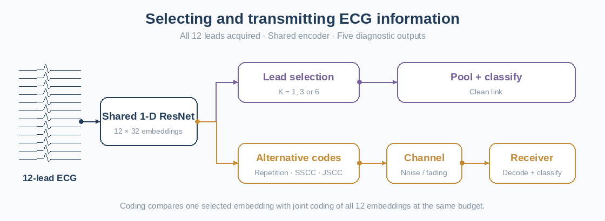

# Selecting and Transmitting ECG Information Under a Limited Wireless Budget

Research code for selecting ECG lead representations and transmitting diagnostic information under a limited wireless budget.



*All 12 leads are acquired and encoded at the transmitter. Lead selection is evaluated over a clean link; alternative coding schemes are compared under matched wireless budgets. Animation is schematic.*

## Overview

A shared 1-D ResNet encodes each lead into 32 features. A record-specific selector scores each lead in the context of the full recording. Transmission experiments compare ranked repetition, separate source–channel coding (SSCC), and learned joint source–channel coding (JSCC) of one or all 12 embeddings.

- **Lead selection:** matched fixed leads, population ranking, random selection, and fixed subsets.
- **Transmission:** AWGN and fading channels, channel estimation, and 8/16/32-use budget comparisons.
- **Evaluation:** five diagnostic superclasses on PTB-XL and CD/partial STTC on an independent ECG cohort.

Single-lead selection improves PTB-XL macro-AUROC, with gains for CD and MI and a loss for STTC. Joint coding of all 12 embeddings performs best among the tested schemes at the 16-use budget. External CD AUROC improves while AUPRC declines.

## Quick start

```bash
git clone https://github.com/puyangzhao/ecg-semantic-communication.git
cd ecg-semantic-communication/code/pipeline
conda env create -f environment.yml
conda activate ecg_semcomm
python -m pip install --no-deps wfdb==4.3.1
export PYTHONNOUSERSITE=1
```

The pinned environment records the analysis versions. `wfdb` is installed separately because its declared pandas requirement differs from the pandas version used in the analyses. GPU training is configured by default; use `device: cpu` in a copied configuration for CPU runs.

### Generate figures and tables

From the repository root, using the environment above:

```bash
python code/make_all.py --out outputs/paper
```

This reads aggregate results in `code/data/`; no ECG downloads or training are needed. It generates analytical figures and tables. The hand-edited manuscript layout and legacy plots are not recreated by this command.

### Train and evaluate

Download [PTB-XL 1.0.3](https://physionet.org/content/ptb-xl/1.0.3/) and follow the [pipeline guide](code/pipeline/README.md). The official folds are used: 1–8 training, 9 validation, 10 testing. External evaluation uses [ECG-Arrhythmia 1.0.0](https://physionet.org/content/ecg-arrhythmia/1.0.0/).

```bash
cd code/pipeline
python scripts/run_data_audit.py
python scripts/train_baseline.py --config configs/baseline.yaml --run-name baseline_run1
python scripts/precompute_embeddings.py
python scripts/train_phase2a.py --method proposed --seed 0 --config configs/phase2a.yaml --run-name phase2a_proposed_seed0
```

## Repository

| Path | Contents |
|---|---|
| `code/pipeline/src/` | Encoders, selectors, channels, losses and metrics |
| `code/pipeline/scripts/` | Encoder and downstream training |
| `code/pipeline/configs/` | Model and training configurations |
| `code/pipeline/revision_audit/` | Matched comparisons, external evaluation and stability analyses |
| `code/pipeline/revision2/` | Budget and channel experiments |
| `code/data/` | Aggregate results for plotting |
| `code/make_all.py` | Figure and table generation |
| `assets/` | Animated method overview and its rendering script |

Raw ECGs, patient-level predictions and trained checkpoints are not distributed here. Download data under the providers' terms and train models with the supplied pipeline. Aggregate summaries are included to reproduce the reported plots. The exploratory switching analysis and post hoc stability analyses remain identified separately.

## Citation

```bibtex
@misc{zhao_ecg_information,
  title = {Selecting and Transmitting ECG Information Under a Limited Wireless Budget},
  author = {Zhao, Puyang and Zhao, Jingxi and Zhang, Huiyun},
  year = {2026},
  howpublished = {Research code},
  url = {https://github.com/puyangzhao/ecg-semantic-communication}
}
```

## License

Code: [MIT](LICENSE). Dataset and bundled font licenses remain with their respective providers.
